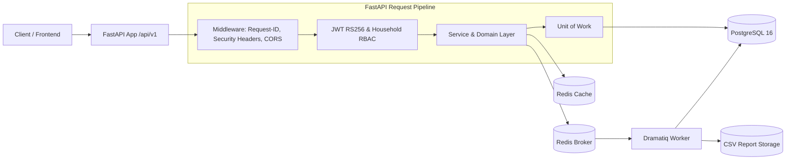

# Hesabi API — Personal & Household Financial Management Backend

[](https://www.python.org/)
[](https://fastapi.tiangolo.com/)
[](https://www.postgresql.org/)
[](https://www.sqlalchemy.org/)
[](https://redis.io/)
[](https://dramatiq.io/)

**Hesabi** is an asynchronous, multi-tenant personal and household budget-tracking backend built with **FastAPI**, **async SQLAlchemy 2.0**, **PostgreSQL 16**, **Redis**, and **Dramatiq**. Originally prototyped as a single-user Flask + SQLite application, the system has been re-architected into a layered, production-oriented backend featuring asymmetric JWT authentication (`RS256`), household-level Role-Based Access Control (`RBAC`), OWASP BOLA object-level ownership enforcement, pessimistic row-level locking (`SELECT ... FOR UPDATE`), cache-aside invalidation, and asynchronous background job processing.

---

## Table of Contents

- [System Architecture](#system-architecture)
- [Core Engineering Features](#core-engineering-features)
- [Tech Stack](#tech-stack)
- [Project Structure](#project-structure)
- [API Overview (`/api/v1`)](#api-overview-apiv1)
- [Getting Started](#getting-started)
  - [Prerequisites](#prerequisites)
  - [Environment & RSA Key Setup](#environment--rsa-key-setup)
  - [Running with Docker Compose](#running-with-docker-compose)
  - [Running Locally with `uv`](#running-locally-with-uv)
- [Testing & Quality Assurance](#testing--quality-assurance)
- [Architecture Decision Records (ADRs)](#architecture-decision-records-adrs)
- [Development Roadmap](#development-roadmap)

---

## System Architecture

Hesabi follows a strict layered architecture separating HTTP transport, security/RBAC dependencies, domain validation, unit-of-work persistence, and asynchronous workers:



---

## Core Engineering Features

- **Multi-Tenant Household Model & RBAC:** Users automatically receive a personal workspace upon registration and can collaborate in shared households under three strict roles (`OWNER`, `MEMBER`, `VIEWER`) enforced via composable FastAPI dependencies (`RequireRole`) and object-level ownership guards against **BOLA (OWASP API1)**.
- **Asymmetric Authentication (`JWT RS256`):** Stateless access tokens (`15m` TTL) and refresh token rotation (`7d` TTL) signed with RSA private/public key pairs (`PyJWT`) and password hashing via `Argon2` (`pwdlib`).
- **Concurrency Safety & Query Optimization:** Prevents lost updates under concurrent spending bursts using PostgreSQL pessimistic row-level locking (`SELECT ... FOR UPDATE`), backed by composite indexes (`(household_id, date DESC)`, `(household_id, category_id, type, amount)`) verified via `EXPLAIN ANALYZE` query plans.
- **Cache-Aside & Targeted Invalidation:** Caches household financial summaries and category balance rollups in Redis with deterministic write-through invalidation whenever transactions or categories are created, updated, or deleted.
- **Asynchronous Background Workers (`Dramatiq`):** Offloads long-running and scheduled tasks to Redis-backed Dramatiq actors with automatic retries (`max_retries=3`):
  - **Async CSV Report Exports:** Non-blocking job creation (`202 Accepted`), status polling, and requester-scoped file downloads.
  - **Recurring Transaction Scheduling:** Delayed message scheduling (`send_with_options`) for automated daily recurring expense/income generation.
- **Centralized Error Contract & Request Tracing:** Unified `AppError` exception hierarchy (`401`, `403`, `404`, `422`) with structured JSON error payloads, `X-Request-Id` propagation, and baseline security headers (`X-Content-Type-Options`, `X-Frame-Options`).
- **Versioned OpenAPI Specification:** Frozen `/api/v1` URI path versioning with full Pydantic v2 request/response contracts and reusable route deprecation headers.

---

## Tech Stack

| Layer | Technology |
| :--- | :--- |
| **Web Framework** | FastAPI, Uvicorn, Pydantic v2, Pydantic Settings |
| **Database & ORM** | PostgreSQL 16, SQLAlchemy 2.0 (`asyncio` + `asyncpg`), Alembic |
| **Cache & Message Broker** | Redis, Dramatiq |
| **Security & Auth** | `PyJWT[crypto]` (`RS256`), `pwdlib[argon2]` |
| **Package & Runtime Management** | Python 3.12+, `uv`, Docker & Docker Compose |
| **Testing & Tooling** | `pytest`, `pytest-asyncio`, `httpx`, `testcontainers`, `fakeredis`, `ruff`, `mypy`, `bandit` |

---

## Project Structure

```text
hesabi_fastapi/
├── alembic/                    # Database schema migrations & version history
│   └── versions/
├── app/
│   ├── api/v1/                 # Versioned REST routers, endpoints & OpenAPI schema
│   │   ├── endpoints/          # auth, users, category, transaction, compute, reports, recurring_transaction
│   │   └── router.py
│   ├── db/                     # Async engine, ORM models, repositories (CRUD), Redis & Unit of Work
│   ├── errors/                 # Centralized AppError hierarchy & FastAPI exception handlers
│   ├── broker.py               # Dramatiq Redis broker & delayed-task enqueue helpers
│   ├── cache.py                # Redis key builders, JSON/Decimal serializers & cache invalidation
│   ├── config.py               # Typed Pydantic Settings (.env / .env.test / .env.production)
│   ├── dependencies.py         # DI wiring, JWT current-user extraction & RBAC guards
│   ├── domain_models.py        # Pure domain entities & business rule invariants
│   ├── main.py                 # FastAPI application factory, lifespan & OpenAPI tags
│   ├── middleware.py           # CORS, X-Request-Id tracing & HTTP security headers
│   ├── schemas.py              # Pydantic request/response DTOs
│   ├── security.py             # RS256 token signing/verification & Argon2 password hashing
│   ├── service.py              # Application business logic & transactional orchestration
│   ├── validators.py           # Reusable schema/field validators
│   └── worker.py               # Dramatiq background actors (CSV reports & recurring transactions)
├── docs/
│   ├── decisions/              # 15 Architecture Decision Records (ADR-001 through ADR-015)
│   ├── Household RBAC & BOLA Access Matrix.md
│   ├── VERSIONING.md
│   ├── GIT_WORKFLOW.md
│   └── hesabi-24-point-roadmap.md
├── sandbox/                    # Standalone verification scripts (concurrency races, EXPLAIN plans, seeders)
├── tests/                      # Diamond test suite (unit, integration, contract)
│   ├── unit/
│   ├── integration/
│   └── contract/
├── docker-compose.yml          # Multi-container stack (db, redis, app, worker)
├── Dockerfile                  # Python 3.12 + uv container build
├── Makefile                    # Common developer automation targets
└── pyproject.toml              # Project dependencies & tool configurations
```

---

## API Overview (`/api/v1`)

Interactive API documentation is available at `/docs` (Swagger UI) and `/redoc` once the server is running.

| Domain | Base Path | Key Capabilities |
| :--- | :--- | :--- |
| **Auth** | `/api/v1/auth` | User registration (`POST /register`), `RS256` login (`POST /login`), token refresh (`POST /refresh`) |
| **Users** | `/api/v1/users` | Authenticated user profile & personal household lookup (`GET /me`) |
| **Categories** | `/api/v1/households/{household_id}/categories` | CRUD for budget categories & monthly spending goals (`OWNER`-restricted writes) |
| **Transactions** | `/api/v1/households/{household_id}/transactions` | Income/expense recording with concurrency-safe budget tracking & ownership checks |
| **Compute** | `/api/v1/households/{household_id}/compute` | Redis-cached overall financial summaries & per-category budget utilization |
| **Recurring** | `/api/v1/households/{household_id}/recurring_transaction` | Automated recurring transaction template management |
| **Reports** | `/api/v1/households/{household_id}/reports` | Asynchronous CSV report export queueing, status polling & file download |

---

## Getting Started

### Prerequisites

- **Docker & Docker Compose** (recommended for running PostgreSQL, Redis, API, and Worker together)
- **Python 3.12+** and **[`uv`](https://docs.astral.sh/uv/)** (for local execution and running the test suite)
- **OpenSSL** (to generate local `RS256` key pairs)

### Environment & RSA Key Setup

1. **Clone the repository:**
   ```bash
   git clone [https://github.com/mhmdkhajouei/hesabi_fastapi.git](https://github.com/mhmdkhajouei/hesabi_fastapi.git)
   cd hesabi_fastapi
   ```

2. **Create your environment file:**
   ```bash
   cp .env.example .env
   ```
   Update `.env` with matching database credentials (defaults in `docker-compose.yml`):
   ```env
   ENV=development
   LOG_LEVEL=DEBUG
   DB_USER=myuser
   DB_PASSWORD=mypassword
   DB_HOST=db
   DB_PORT=5432
   DB_NAME=hesabi_db
   REDIS_HOST=redis
   REDIS_PORT=6379
   ```

3. **Generate `RS256` JWT signing keys:**
   ```bash
   mkdir -p certs
   openssl genrsa -out certs/private_key.pem 2048
   openssl rsa -in certs/private_key.pem -pubout -out certs/public_key.pem
   ```

### Running with Docker Compose

Start PostgreSQL, Redis, the FastAPI server, and the Dramatiq background worker:

```bash
make up
# or: docker compose up -d --build
```

Apply Alembic database migrations:

```bash
docker compose exec app uv run alembic upgrade head
```

The API will be available at **`http://localhost:8000`** and interactive Swagger docs at **`http://localhost:8000/docs`**.

### Running Locally with `uv`

If you prefer running the API and worker processes directly on your host machine while keeping Postgres and Redis in Docker:

```bash
docker compose up -d db redis
uv sync
uv run alembic upgrade head
make run
# In a separate terminal for background jobs:
uv run dramatiq app.worker
```

---

## Testing & Quality Assurance

The test suite follows a **Diamond Testing Strategy** (`docs/decisions/010_diamond_pytest_strategy.md`), combining fast unit tests, real PostgreSQL integration tests (`testcontainers`), and OpenAPI contract validation:

```bash
# Run the full test suite
make test

# Run individual test layers
uv run pytest tests/unit
uv run pytest tests/integration
uv run pytest tests/contract
```

---

## Architecture Decision Records (ADRs)

Key architectural trade-offs and benchmarks are documented under `docs/decisions/`:

- **ADR-001 – ADR-004:** FastAPI selection, PostgreSQL + async SQLAlchemy 2.0, Alembic migrations, Pydantic Settings
- **ADR-005 – ADR-006:** Centralized `AppError` hierarchy & URI path API versioning (`/api/v1`)
- **ADR-007 – ADR-009:** `RS256` JWT key pairs & token TTLs, Household RBAC matrix, OWASP BOLA prevention
- **ADR-010:** Diamond testing strategy with `pytest` & `testcontainers`
- **ADR-011 – ADR-012:** Pessimistic locking (`SELECT ... FOR UPDATE`) for concurrent budget updates & `EXPLAIN ANALYZE` indexing benchmarks
- **ADR-013 – ADR-015:** Redis cache-aside invalidation & Dramatiq background job/delayed-message architecture

---

## Development Roadmap

This project is actively developed against a structured 24-point backend engineering roadmap (`docs/hesabi-24-point-roadmap.md`):

- [x] **Foundations & Contracts:** FastAPI, async SQLAlchemy 2.0, PostgreSQL 16, Alembic migrations, Pydantic Settings, Middleware, CORS, centralized error handling, `/api/v1` OpenAPI contracts
- [x] **Security & Multi-Tenancy:** `RS256` JWT auth + refresh rotation, Household RBAC (`OWNER` / `MEMBER` / `VIEWER`), OWASP BOLA ownership enforcement
- [x] **Testing, Concurrency & Async Jobs:** Unit/Integration/Contract test suite, `SELECT ... FOR UPDATE` concurrency locking, `EXPLAIN ANALYZE` composite indexing, Redis cache-aside invalidation, Dramatiq CSV report export & delayed recurring transactions
- [ ] **Resilience, Observability & Hardening (In Progress):** Transaction idempotency keys, circuit breakers & feature flags, `structlog` + OpenTelemetry + Prometheus `/metrics`, liveness/readiness probes, k6 load benchmarks & `py-spy` flamegraph profiling